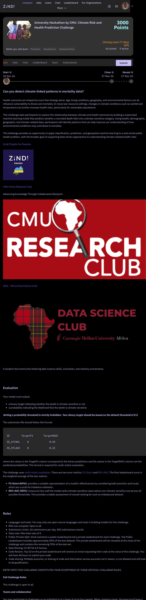

# 🌍 Climate Risk and Health Prediction Challenge (CMU University Hackathon)



## Can you detect climate-linked patterns in mortality data?

This folder holds the kick-off material for the **University Hackathon by CMU: Climate Risk and Health Prediction
Challenge** on [Zindi](https://zindi.world/competitions/climate-risk-health-prediction-cmu-hackathon). It runs from
**20 to 27 November 2026**, with the CMU-Africa Data Science Club, the CMU-Africa Research Club and the Zindi
Chapter for Rwanda.

The task is **binary classification**: for each recorded death in Uganda, predict whether it falls into a
**climate-sensitive** category. The inputs are age, gender, place, date and climate measurements.

| Resource | Link |
|---|---|
| Challenge page | [zindi.world/competitions/climate-risk-health-prediction-cmu-hackathon](https://zindi.world/competitions/climate-risk-health-prediction-cmu-hackathon) |
| Baseline notebook (Kaggle) | [climate-health-risk-improved-baseline](https://www.kaggle.com/code/moanlobago/climate-health-risk-improved-baseline) |
| Dataset (Kaggle mirror) | [climate-health-risk-hackathon-data](https://www.kaggle.com/datasets/moanlobago/climate-health-risk-hackathon-data) |
| Baseline notebook (this folder) | [climate-health-risk-improved-baseline.ipynb](climate-health-risk-improved-baseline.ipynb) |

---

## 📊 Problem overview

Health outcomes depend on more than biology. Rainfall, temperature and the environment shape diseases such as
malaria, diarrhoea and respiratory infections, and these hit young children hardest. The model learns from
health, demographic, geographic and climate data to flag deaths that fall into climate-sensitive categories.

## 🧾 Data

| File | Contents |
|---|---|
| `Train.csv` | One row per recorded death, with the target `is_climate_sensitive` (1 = climate-sensitive) |
| `Test.csv` | The same columns without the target. These are what you predict |
| `climate_features.csv` | Climate and environment measurements per death: rain and temperature over the previous 7, 30 and 90 days, NDVI (vegetation), elevation, slope. Join on `ID` |
| `SampleSubmission.csv` | The submission format |
| `data_dictionary.csv`, `downloaded_climate_features_data_dictionary.csv` | Descriptions of every column |

About 65% of training deaths are climate-sensitive. **The test deaths come from villages that are almost never in
the training data**: only 1 of the 11 test villages appears in train.

The data is **not stored in this repository**. See [data/README.md](data/README.md) for how to get it.

> **Licence:** the data is shared under **CC BY-SA 4.0** by the Zindi challenge. Keep this attribution if you
> share the data or anything derived from it.

## 📏 Evaluation

```
score = 0.6 × F1 (on TargetF1) + 0.4 × ROC-AUC (on TargetRAUC)
```

The submission has three columns:

| Column | Meaning |
|---|---|
| `ID` | The death's ID from `Test.csv` |
| `TargetF1` | The 0/1 label, using the **default 0.5 cut-off** |
| `TargetRAUC` | The raw probability of being climate-sensitive (not rounded) |

## ⚙️ The improved baseline

[climate-health-risk-improved-baseline.ipynb](climate-health-risk-improved-baseline.ipynb) is a **starting point,
not a winning solution**. It runs on CPU in about a minute on a laptop, Colab or Kaggle, and needs only pandas,
NumPy, scikit-learn and matplotlib.

| | Held-out-village validation score |
|---|---|
| Zindi starter notebook (logistic regression, random split) | ≈ 0.771 |
| **Improved baseline** (gradient boosting, village split) | **≈ 0.80** |

What it changes, and why:

1. **Honest validation.** Since the test villages are new, the notebook validates with `GroupKFold` by village.
   The starter's random 80/20 split mixes the same villages into both sides, so its score looks better than it
   really is (0.806 on a random split, but only 0.771 on held-out villages).
2. **Features with a clear reason:**
   - age groups (infant, under 5, elderly) and log age, because age is the strongest signal;
   - season as month sine and cosine, plus day of year and year;
   - temperature range and rainy day;
   - zone and gender as 0/1 columns.
3. **No village identifiers.** It drops `location`, `latitude` and `longitude`, so the model cannot memorise villages.
4. **One scikit-learn model**: `HistGradientBoostingClassifier` with small, regularised trees, since the training
   set has only about 3,000 rows.

The notebook also:
- breaks the score down into its F1 and ROC-AUC parts;
- checks accuracy by age group;
- shows permutation importance on held-out villages;
- writes `submission.csv`.

### Run it

1. Get the data (see [data/README.md](data/README.md)) and put the CSVs in `data/` or next to the notebook. On
   Kaggle, attach the dataset. On Colab, upload the files to `/content`.
2. Install the requirements: `pip install -r requirements.txt`. On Kaggle and Colab they are already installed.
3. Run all cells. The notebook finds the data folder by itself and writes `submission.csv`.

## 🚀 Where to go from here

Always compare ideas on the **village** score, and treat changes smaller than the fold-to-fold spread (about 0.01)
as noise.

1. Tune the model, or try LightGBM, XGBoost or CatBoost.
2. Average several different models (for example gradient boosting plus logistic regression).
3. Finer age features, within the first year of life and between 1 and 5.
4. Climate anomalies: is it unusually wet or hot *for that place and season*? Compute this without the target.
5. Interactions, for example rain × young children.
6. Repeat `GroupKFold` with different village groupings, and average, so you don't chase noise.

## ⚖️ Rules to remember

These are summarised from the challenge page. The official rules on Zindi take precedence.

- **Do not tune the 0.5 threshold**, and do not round probabilities.
- Open-source tools only. Openly available pretrained models are allowed. AutoML and paid services are not.
- External data must be **publicly available** (for example ERA5, CHIRPS, NDVI, land surface temperature), and its
  sources shared on the challenge forum.
- Teams have at most 4 members. Use one account per person.
- **Don't share code privately outside your team.** Code shared with others must be posted publicly on the platform.
- Submissions: at most 10 per day and 300 in total. Pick 2 final submissions for the private leaderboard.
- The top 10 must send reproducible code (seed set) within 48 hours of being contacted.

## 📁 Folder layout

```
CMU Climate Risk and Health Prediction Challenge/
├── README.md                                     this file
├── climate-health-risk-improved-baseline.ipynb   the improved baseline
├── requirements.txt                              libraries the notebook needs
├── IMG/CompPage.png                              challenge page screenshot
├── data/README.md                                how to get the data (CSVs are not committed)
└── Winning solutions/                            top 3 solutions, added after the reveal
```
